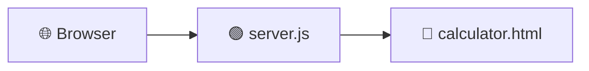

<div align="center">


<b><i>HTML · CSS · JS calculator served with Node.js & Docker</i></b>


    

   
</div>

---

## 🧮 About the Project

A responsive **calculator web app** built with **HTML, CSS and JavaScript**, served by a tiny **Node.js** server and fully **containerised with Docker** — a perfect mini-project to learn front-end basics *and* deployment.

## ✨ Key Features

- 🖩 Clean calculator UI with all basic operations
- 🟢 Zero-dependency Node.js HTTP server (`server.js`)
- 🐳 One-command Docker build & run
- ☁️ Ready to deploy on any cloud VM / container service

## 🧠 How It Works



## 🛠️ Tech Stack

| Layer | Technology |
|---|---|
| Frontend | HTML5 · CSS3 · JavaScript |
| Server | Node.js |
| DevOps | Docker |

## 📂 Project Structure

```text
CALCULATOR-WEB-APP/
├── calculator.html   # UI + logic
├── server.js         # Node.js static server
└── Dockerfile
```

## 🚀 Getting Started

```bash
git clone https://github.com/PreciousBharath/CALCULATOR-WEB-APP.git
cd CALCULATOR-WEB-APP
node server.js
# or with Docker 🐳
docker build -t calculator-web-app .
docker run -p 3000:3000 calculator-web-app
```

> 💡 Check `server.js` / `Dockerfile` for the exact port if it differs from 3000.

## 🤝 Contributing

Contributions, issues and feature requests are welcome! Feel free to ⭐ star the repo and open a pull request.

## 👨‍💻 Author

<div align="center">

**Bharath** — Software Developer · Project Engineer · Technical Trainer

<a href="https://github.com/PreciousBharath"></a>
<a href="https://linkedin.com/in/connectbharath"></a>

### 🍔 EAT · 💻 CODE · 😴 SLEEP · 🔁 REPEAT

⭐ **If you found this project useful, give it a star!** ⭐


</div>
